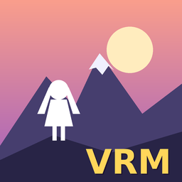

# PeakVRoid

A BepInEx mod for the Steam version of **PEAK** that lets you play as **your own VRM avatar**
(VRoid Studio, VRM 0.x and VRM 1.0) and adds a **third-person camera**.



## Features

- **Any `.vrm` file, loaded at runtime.** No Unity project, no asset bundles, no conversion step.
  Meshes, skinning, blend shapes, textures, materials, the humanoid rig, spring bones, blink and first-person settings are all read from the file.
- **Follows the scout exactly.** Every humanoid bone copies the scout's animated bodyparts (walking, climbing, ragdoll, emotes),
  and two-bone IK puts the avatar's hands on the scout's hands (held items, climbing grips) and its feet on the ground,
  whatever its proportions or rest pose (A-pose and T-pose both work).
- **Hair and clothes physics** (VRM spring bones with sphere and capsule colliders) and **automatic blinking**.
- **Third-person camera** (F5): over-the-shoulder, wall collision, zoom, shoulder swap. The camera is only moved while the frame
  renders, so PEAK's own camera logic, aiming and interaction are untouched.
- **Friends as avatars (local only):** put `players/<SteamName>.vrm` in the avatar folder.
- **Single DLL, no extra dependencies** beyond BepInEx.

## Installing (players)

| Option | Steps |
| --- | --- |
| **Mod manager** (r2modman, Gale, Thunderstore App) | Install **PeakVRoid**. BepInEx comes with it. |
| **One-click installer** (Windows) | Download `PeakVRoid-manual-x.y.z.zip` from [Releases](../../releases), extract it, and double-click **`Install PeakVRoid.bat`**. It finds PEAK via Steam, installs BepInEx if needed, installs the mod and lets you pick your `.vrm`. |
| **By hand** | Install [BepInExPack_PEAK](https://thunderstore.io/c/peak/p/BepInEx/BepInExPack_PEAK/), then copy `BepInEx/plugins/PeakVRoid/PeakVRoid.dll` from the manual zip into the same place in your PEAK folder. |

Then put your avatar into **`BepInEx/config/PeakVRoid/`** (the folder is created on first launch) and press **F6** in game, or restart.

### Controls

| Key | Action |
| --- | --- |
| F5 | Toggle first / third person |
| PageUp / PageDown | Zoom the third-person camera |
| F9 | Swap the shoulder |
| F6 | Reload avatar files from disk |
| F7 | Avatar on / off |
| F8 | Next avatar in the folder |

Everything is configurable in `BepInEx/config/com.peakvroid.peakvroid.cfg`:

| Section | Setting | Default | |
| --- | --- | --- | --- |
| Avatar | `File` | *(first .vrm)* | File name in the avatar folder, or a full path |
| Avatar | `ScaleMode` | `MatchHeight` | `MatchHeight`, `MatchLegs` or `Original` |
| Avatar | `ScaleMultiplier`, `HeightOffset` | 1, 0 | Fine-tune size and floor contact |
| Avatar | `ArmMode` | `ReachScoutHands` | `ReachScoutHands` (hands on items/grips), `MatchShoulders` (arms closer to the body), `CopyRotation` (no arm IK) |
| Avatar | `ShowBackpack`, `BackpackDistance`, `BackpackHeight` | on, 1, 0 | Worn backpack on the avatar's back (also shows your own backpack in third person) |
| Avatar | `LimbIK`, `Fingers`, `SpringBones`, `AutoBlink`, `HideHeadInFirstPerson` | on | |
| Avatar | `OtherPlayersAvatars` / `UseMyAvatarForEveryone` | on / off | Local-only avatars for other players |
| Materials | `Unlit`, `ShadeLift`, `ShaderOverride` | off, 0.15, — | How MToon is approximated |
| Camera | `ThirdPersonByDefault`, `Distance`, `Height`, `ShoulderOffset`, `Collision` | on, 2.6, 0.35, 0.45, on | |

## Limitations

- Avatars are **client-side**. Other players see the normal scout unless they also run the mod and have your file.
- MToon is approximated with PEAK's URP Lit/Unlit shaders (outlines and rim lighting aren't reproduced).
- VRM 1.0 constraints, look-at and expressions other than blink aren't applied.
- In third person the game's interaction ray still starts from the first-person eye, which is very close to where the centre of the screen points.

## Building

Only the .NET SDK (8 or newer) is needed. The project references BepInEx and the stock Unity 6 engine modules from NuGet.
PEAK's own code is accessed through reflection (`src/PeakVRoid/Game/Peak.cs`), so **no game files are needed to build**, and CI can produce releases.

```bash
dotnet build src/PeakVRoid/PeakVRoid.csproj -c Release -t:Package
```

This writes `dist/PeakVRoid-thunderstore-<ver>.zip` and `dist/PeakVRoid-manual-<ver>.zip`.
Set `PEAK_DIR` to your game folder to also copy the DLL into `BepInEx/plugins/PeakVRoid` on every build.

To check that the parser handles a file:

```bash
dotnet run --project tests/VrmParseCheck -c Release -- path/to/avatar.vrm
```

Pushing a `v*` tag builds both zips and attaches them to a GitHub release. Bump `Version` in the `.csproj` and
`version_number` in `thunderstore/manifest.json` together; the build fails if they differ.

### Layout

```
src/PeakVRoid/
  Plugin.cs               entry point, hotkeys, on-screen messages
  ModConfig.cs            all settings
  ThirdPersonCamera.cs    render-time camera offset + collision
  Game/Peak.cs            reflection access to PEAK (Character, bodyparts, MainCamera)
  Game/Keys.cs            hotkeys via legacy Input or the Input System
  Vrm/                    Unity-free glTF/JSON parser + Unity mesh/material/VRM builder
  Avatar/                 retargeting + IK (AvatarDriver), spring bones, blinking, avatar management
install/                  one-click Windows installer
thunderstore/             Thunderstore manifest, icon, README, changelog
tests/VrmParseCheck/      parser smoke test
```

## License

MIT. VRM avatars keep their own licenses. Check what your model allows.
